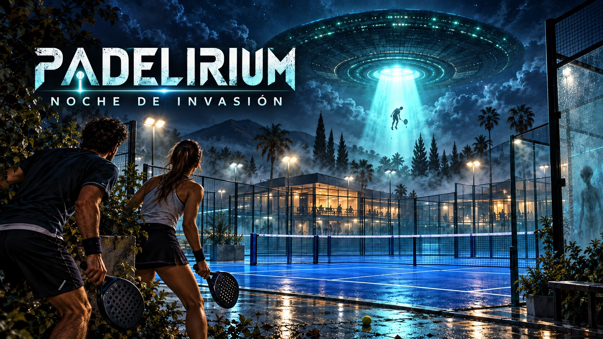
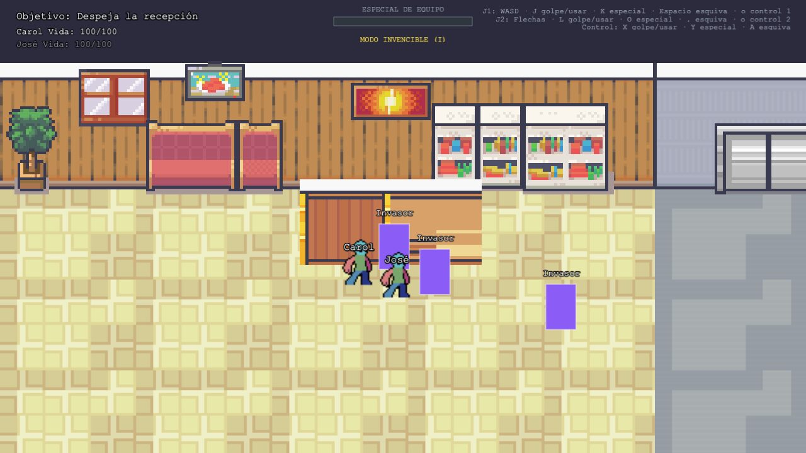
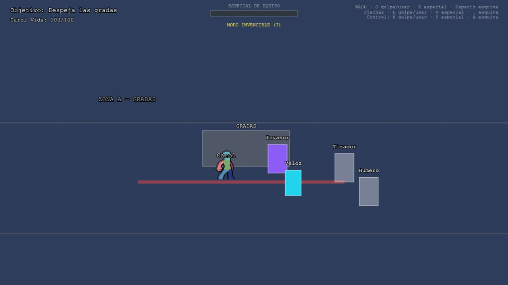
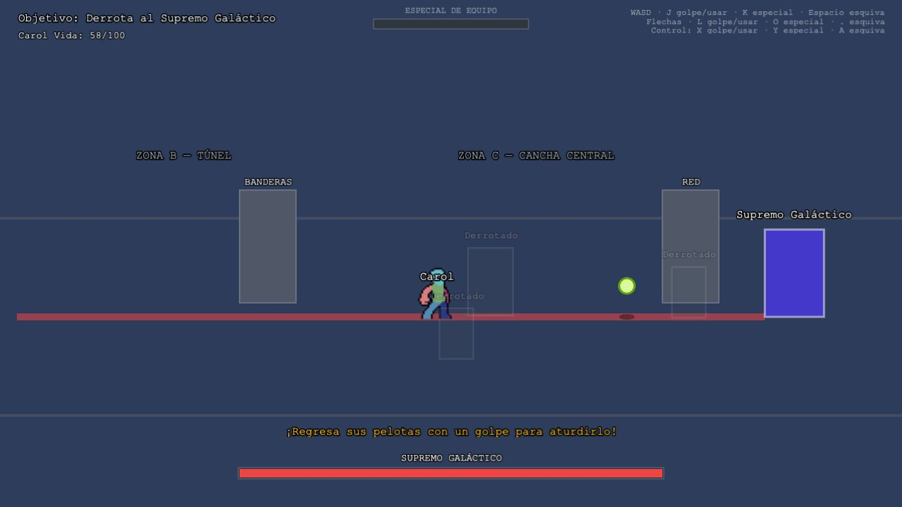
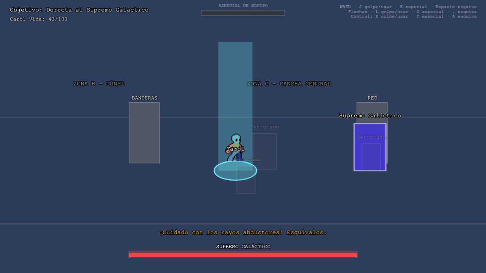
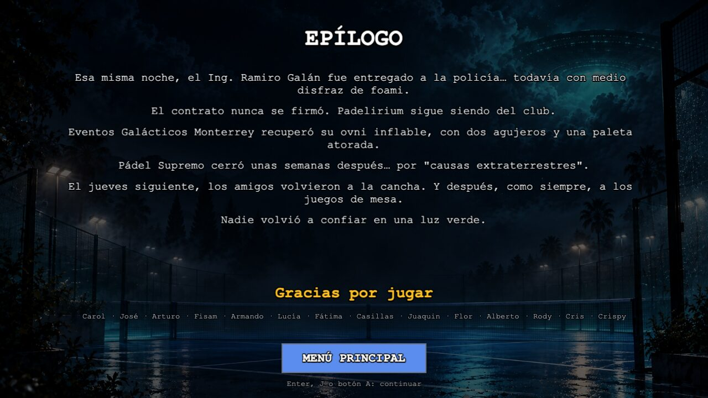

# Padelirium: Noche de Invasión



Un *beat 'em up* cooperativo, en el navegador, sobre un grupo de amigos que juegan pádel en **Padelirium**, su club favorito. Una noche llega un ovni, se lleva a casi todos y solo quedan Carol y José, con la paleta en la mano. Hay que recorrer el club cuarto por cuarto, repartir golpes y rescatar a los demás.

Y mientras más amigos rescatas, más raro se pone todo: ¿desde cuándo los aliens rentan máquinas de humo?

Hecho con [Phaser 3](https://phaser.io/), TypeScript y Vite.

**Jugar:** https://joemag50.github.io/saving-padelarium/ (se publica solo al hacer push a `main`).

---

## Capturas

| | |
|---|---|
|  |  |
| **Nivel 1 — La recepción.** Escenario hecho con tiles; la cámara se bloquea en cada pelea. | **Seis tipos de enemigo.** El Tirador avisa con una línea roja antes de lanzarte una pelota. |
|  |  |
| **El Supremo Galáctico, fase 1.** Regrésale la pelota con un golpe para aturdirlo. | **Fase 3.** Los rayos abductores atrapan; tu pareja te libera golpeando el rayo. |



---

## Cómo se juega

- **1 o 2 jugadores** en el mismo teclado, o con controles.
- Eliges a tu personaje al inicio y lo usas en toda la partida.
- Cada nivel tiene dos cuartos. Al entrar a uno, **la cámara se bloquea** hasta que derrotas a todos; luego aparece **"¡ADELANTE! →"**.
- En el segundo cuarto está el líder del escuadrón. Al vencerlo, acércate a tus amigos para rescatarlos: lo que te cuentan es la única pista de lo que está pasando.
- Cada amigo rescatado se desbloquea como personaje jugable (para tu próxima partida).
- El **especial de equipo** se carga con cada golpe que conectas y golpea a todos alrededor.

### Controles

| | Moverse | Golpe / usar | Especial | Esquivar |
|---|---|---|---|---|
| **Jugador 1** | `W` `A` `S` `D` | `J` | `K` | `Espacio` |
| **Jugador 2** | Flechas | `L` | `O` | `.` |
| **Control** | Stick / cruceta | `X` | `Y` | `A` |

En los menús: `Enter`, `J` o botón `A` para confirmar; `Esc` o `B` para regresar.

### Los niveles

| # | Nivel | Rescatas a | Enemigos nuevos |
|---|---|---|---|
| 1 | La recepción | Rody y Alberto | Invasor |
| 2 | Los vestidores | Arturo y Fisam | Humero |
| 3 | La cafetería | Armando y Lucía | Veloz, Tirador |
| 4 | El estacionamiento | Juaquin y Flor | Grandote |
| 5 | La oficina | Fátima y Casillas | Escudero |
| 6 | La cancha central | Cris y Crispy | Todos + el jefe final |

### Los enemigos

| Tipo | Qué hace | Cómo ganarle |
|---|---|---|
| **Invasor** | Se acerca y golpea | Golpéalo primero: un golpe interrumpe su ataque |
| **Veloz** | Toma distancia y embiste a través de ti | Esquiva y contraataca |
| **Grandote** | Lento, mucha vida, golpe fuerte; no se deja empujar | No te quedes enfrente cuando carga |
| **Tirador** | Te lanza pelotas de pádel por tu carril | Cambia de carril, o regrésale la pelota con un golpe |
| **Escudero** | Escudo al frente; tarda en voltear | Rodéalo por otro carril y pégale por la espalda |
| **Humero** | Lanza bombas de humo que marcan el piso | Sal de la zona marcada |

Nunca te atacan más de dos cuerpo a cuerpo a la vez: los demás esperan alrededor su turno.

### El jefe final: el Supremo Galáctico

1. **El Saque.** Saca pelotas por carriles. Regresa una con un golpe para aturdirlo; solo así le haces daño.
2. **La Embestida.** Tiene escudo al frente y embiste de lado a lado. Pégale por la espalda o deja que se estrelle contra la pared.
3. **La Abducción.** Lanza rayos que atrapan. En pareja, golpea el rayo para liberar a tu compañero.
4. **El golpe final** tiene que ser el especial de equipo.

Si los dos jugadores le pegan casi al mismo tiempo mientras está aturdido, sale **"¡GOLPE DE PAREJA!"** con daño extra.

<details>
<summary><b>Spoilers:</b> ¿quién está detrás de la invasión?</summary>

Los "aliens" son personas disfrazadas, pagadas por **Pádel Supremo**, el club rival de enfrente. Su dueño, el Ing. Ramiro Galán, tiene un contrato: si Padelirium cierra "por causas extraterrestres", el terreno pasa a ser suyo. El ovni es un inflable rentado a Eventos Galácticos Monterrey, y el Supremo Galáctico es Galán con un disfraz de foami.

</details>

---

## Desarrollo

Requiere Node 24 (el mismo que usa el despliegue).

```bash
npm install
npm run dev       # servidor local con recarga
npm run build     # verifica tipos y genera dist/
npm run preview   # sirve el build
```

### Herramientas de depuración

Agrega `?debug` a la URL (por ejemplo `http://localhost:5173/?debug`):

| Tecla | Qué hace |
|---|---|
| `I` | Modo invencible (se mantiene entre niveles hasta recargar) |
| `N` | Derrota a todos los enemigos en pantalla |

También dibuja las cajas de golpe y expone el juego en la consola como `window.__game`.

### Dónde ajustar cada cosa

| Quieres cambiar… | Archivo |
|---|---|
| Textos de la historia, objetivos, oleadas y amigos de cada nivel | `src/data/levels.ts` |
| Vida, velocidad, daño y tiempos de cada tipo de enemigo | `src/config/enemies.ts` |
| Toda la pelea del jefe final | `src/config/boss.ts` |
| Golpe, esquiva y especial del jugador | `src/config/combat.ts` |
| Personajes (nombre y color) | `src/data/roster.ts` |
| Texto del epílogo | `src/data/epilogue.ts` |
| Tipografía y estilos de texto | `src/ui/theme.ts` (`FONT_FAMILY`, `TEXT_VARIANTS`) |
| Paredes, pisos y muebles de un nivel | bloque `scenery` en `src/data/levels.ts`; recortes en `src/world/tileAssets.ts` |

### Estructura

```
src/
├── scenes/     Título, jugadores, niveles, personajes, nivel y pantalla final/epílogo
├── core/       EncounterManager: oleadas, turnos de ataque y límites de cada cuarto
├── enemy/      Enemigos (InvaderEnemy), jefe final y sus pelotas, rayos y humo
├── player/     Jugador, controles y sprites del héroe
├── combat/     Vida, golpes, especial de equipo
├── world/      Escenario con tiles, colisión de cuerpos, profundidad
├── ui/         HUD, botones, fondos de menú, tema
├── data/       Niveles, personajes, epílogo
└── config/     Todos los números ajustables
```

---

## Estado del MVP

Los 6 niveles se pueden jugar de principio a fin, con historia, jefe final y epílogo. Pendiente:

- El nivel 1 tiene escenario con tiles; los niveles 2 a 6 todavía son cajas grises.
- Los enemigos y el jefe son rectángulos de color, a la espera de sus sprites.
- Los líderes de cada nivel aún no tienen un ataque propio de su nivel.
- La dificultad está ajustada con pruebas automáticas; falta afinarla jugando.

## Créditos y licencias

- **Arte de portada y fondo de menús:** hecho para este juego por el autor.
- **Escenario:** pack *Modern Interiors* (versión gratuita) de LimeZu. Su licencia permite usarlo solo en **proyectos no comerciales**; está en `public/assets/tiles/LICENSE.txt`. Si el juego se vende algún día, hay que comprar la versión completa.
- **Sprites del héroe:** plantilla en `public/assets/individual_sheets/`.
