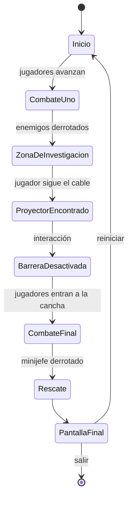

# Padelarium: Invasión de Mentira

## Documento de diseño del MVP

**Tipo de documento:** Especificación de producto y vertical slice jugable  
**Género:** Beat 'em up cooperativo con misterio ligero  
**Alcance:** Un nivel corto, una pareja jugable, una pista y un rescate  
**Estado:** Concepto listo para prototipado  

---

## 1. Resumen del juego

**Padelarium: Invasión de Mentira** es un beat 'em up cooperativo protagonizado por un grupo de amigos que se conocieron jugando pádel y que se reúnen cada semana para jugar juegos de mesa.

Una noche, Padelarium —su club de pádel favorito— es tomado por un grupo de supuestos extraterrestres. Los amigos quedan separados y algunos son capturados. La pareja inicial debe abrirse paso por el club, derrotar a los invasores, encontrar pistas y rescatar al resto del grupo.

El misterio central del juego completo es:

> ¿Quién tomó Padelarium y por qué está fingiendo una invasión extraterrestre?

El MVP no resolverá todo el misterio. Solo demostrará la primera revelación:

> Al menos una parte de la invasión está siendo creada con tecnología terrestre.

---

## 2. Visión del producto

La fantasía principal es:

> Somos un grupo de amigos ordinarios enfrentándonos juntos a una situación absurda que nadie puede explicar.

El juego debe sentirse como una mezcla de:

- una pandilla de amigos resolviendo un misterio;
- un beat 'em up sencillo y cooperativo;
- una aventura ligera donde cada descubrimiento cambia lo que creemos sobre el ataque;
- una celebración caricaturesca de las personalidades del grupo.

El misterio debe motivar el avance, pero no debe detener el ritmo del combate con largas conversaciones, documentos extensos o escenas cinematográficas complejas.

---

## 3. Objetivo del MVP

El MVP debe responder una sola pregunta de diseño:

> ¿Es divertido recorrer Padelarium, pelear, descubrir una pista que cambia nuestra interpretación del ataque y rescatar a un amigo?

El MVP será exitoso si un jugador puede completar un nivel corto y comprender, sin una explicación externa, que:

1. Padelarium fue atacado por supuestos extraterrestres.
2. Una barrera extraña bloqueaba el avance.
3. La barrera era producida por un proyector local.
4. Alguien está fingiendo al menos una parte de la invasión.
5. El grupo debe seguir avanzando para descubrir quién está detrás del ataque.

---

## 4. Alcance cerrado del MVP

### Incluido

- Un nivel continuo de entre 5 y 10 minutos.
- Una pareja jugable.
- Cooperativo local para dos jugadores como objetivo del vertical slice.
- Movimiento en un escenario lateral con profundidad limitada.
- Un ataque básico.
- Una esquiva.
- Una acción de interacción.
- Un ataque especial de pareja.
- Un tipo de enemigo básico.
- Un minijefe.
- Dos encuentros de combate.
- Una barrera aparentemente alienígena.
- Una pista interactiva: un proyector terrestre.
- Una puerta o camino que se desbloquea al resolver la pista.
- Un amigo rescatado al final.
- Una pantalla final que comunica la revelación.
- Reinicio del nivel.

### Fuera de alcance

No implementar en este MVP:

- mundo abierto;
- exploración libre de todo Padelarium;
- inventario;
- armas equipables;
- árbol de habilidades;
- niveles de experiencia;
- economía;
- tiendas;
- múltiples parejas jugables;
- selección completa de personajes;
- diferencias de estadísticas entre personajes;
- profesiones como sistemas jugables;
- conversaciones ramificadas;
- decisiones narrativas;
- múltiples finales;
- sistema de pistas complejo;
- tablero de investigación;
- documentos largos;
- actuación de voz;
- cinemáticas elaboradas;
- multijugador en línea;
- matchmaking;
- guardado de campaña;
- jefe final;
- explicación completa del villano;
- inteligencia artificial avanzada para compañeros;
- generación procedural.

---

## 5. Pareja y elenco

### Pareja del MVP

Usar una sola pareja durante todo el nivel.

La pareja concreta puede elegirse más adelante. Para desarrollo se puede usar temporalmente:

- **Jugador 1:** Carol
- **Jugador 2:** José

Los nombres, retratos y modelos deben ser fáciles de reemplazar.

### Elenco previsto para el juego completo

- Carol y José
- Arturo y Fisam
- Armando y Lucía
- Arturo y Fátima
- Juaquin y Flor
- Alberto, Rody, Cris y Crispy

Este elenco es una referencia futura. El MVP no debe implementar todavía sus diferencias, ataques o desbloqueos.

---

## 6. Perspectiva y presentación

El juego se presenta como un beat 'em up lateral en 2.5D.

El jugador ve:

- a los dos personajes jugables;
- una porción del interior de Padelarium;
- enemigos entrando desde los costados o desde el fondo;
- objetos que pueden inspeccionarse;
- una barrera visual bloqueando el paso;
- una interfaz mínima con vida, energía especial y objetivo actual.

El escenario puede construirse inicialmente con formas, sprites o modelos provisionales. La identidad visual final no es necesaria para validar el núcleo jugable.

### Cámara

La cámara debe:

- seguir al centro aproximado de la pareja;
- impedir que los jugadores se separen demasiado;
- mantener visibles a ambos jugadores durante el combate;
- bloquear el avance hasta que se complete cada encuentro;
- moverse únicamente a lo largo del recorrido del nivel.

No se necesita cámara libre.

---

## 7. Ciclo principal de juego

El ciclo principal es:

> Entrar → combatir → inspeccionar → descubrir → abrir el camino → combatir → rescatar.

La unidad mínima de juego es:

1. Los jugadores entran a una zona.
2. El camino se bloquea.
3. Aparecen enemigos.
4. Los jugadores derrotan a los enemigos.
5. El escenario permite investigar un elemento extraño.
6. Los jugadores encuentran una pista.
7. La pista produce una consecuencia visible en el nivel.
8. El camino se abre.
9. Los jugadores avanzan al siguiente encuentro.

El misterio no se presenta únicamente mediante texto. Debe cambiar físicamente el nivel.

---

## 8. Flujo completo del nivel

### Estado 1: Inicio

Los jugadores aparecen dentro de la recepción de Padelarium.

Información mínima en pantalla:

> Objetivo: Encuentra a los demás.

Al fondo se observa una barrera luminosa que parece alienígena y bloquea el acceso al pasillo de las canchas.

No se necesita introducción cinematográfica extensa. Una pantalla inicial o una animación de pocos segundos es suficiente para establecer que el club fue atacado.

### Estado 2: Primer encuentro

Cuando los jugadores avanzan:

- la salida se bloquea;
- aparecen tres enemigos básicos;
- comienza el primer combate.

Al derrotar a todos los enemigos:

- termina la música o tensión de combate;
- la zona queda disponible para inspección;
- la barrera sigue activa;
- aparece un indicador discreto sobre un cable o dispositivo cercano.

### Estado 3: Inspección de la barrera

Los jugadores pueden acercarse a la barrera y usar la acción de interacción.

La interacción muestra un mensaje breve:

> La barrera no tiene una fuente visible. Un cable se extiende detrás del mostrador.

El cable guía visualmente hacia el proyector.

No se necesita un sistema de deducción libre. El jugador solo debe observar, acercarse e interactuar.

### Estado 4: Descubrimiento del proyector

Detrás del mostrador existe un proyector conectado a la barrera.

Al interactuar con él:

- la barrera parpadea;
- se apaga el proyector;
- desaparece la barrera;
- suena una confirmación;
- aparece una tarjeta de pista.

Texto de la pista:

> **PISTA ENCONTRADA**  
> Proyector holográfico.  
> Etiqueta: “Eventos Galácticos Monterrey”.  
> Alguien está usando equipo local para fingir tecnología extraterrestre.

Después de cerrar la tarjeta:

> Nuevo objetivo: Entra a la cancha y encuentra a tu amigo.

### Estado 5: Segundo encuentro

Los jugadores cruzan el pasillo y entran a una cancha.

Aparece un minijefe acompañado opcionalmente por uno o dos enemigos básicos.

El minijefe puede ser una versión más resistente del enemigo normal. No necesita una inteligencia artificial completamente diferente.

Diferencias mínimas del minijefe:

- más vida;
- ataque más lento y más fuerte;
- nombre visible;
- breve animación de entrada;
- resistencia parcial al aturdimiento.

### Estado 6: Rescate

Al derrotar al minijefe:

- se abre una puerta, jaula o zona bloqueada;
- aparece el amigo rescatado;
- los personajes se acercan;
- se muestra una línea breve.

Ejemplo:

> “No son aliens. Escuché que hablaban de un montaje.”

No se necesita diálogo interactivo.

### Estado 7: Final del MVP

Se muestra una pantalla final:

> **NUEVA PISTA**  
> La invasión utiliza tecnología terrestre.  
> Alguien está fingiendo ser extraterrestre.

Después:

> **Amigo rescatado**  
> La investigación continuará.

Opciones:

- Reiniciar nivel.
- Salir al menú.

---

## 9. Diagrama de estados



---

## 10. Controles mínimos

### Movimiento

- Desplazamiento horizontal.
- Desplazamiento limitado en profundidad.
- Sin salto durante el MVP.

### Ataque básico

- Un botón de ataque.
- Puede reproducir una secuencia corta de uno a tres golpes al presionarlo repetidamente.
- Si el combo complica la implementación, usar un solo golpe reutilizable.
- El ataque debe producir retroalimentación clara al conectar.

### Esquiva

- Movimiento corto con una ventana breve de invulnerabilidad.
- Tiempo de recuperación suficiente para evitar uso continuo.
- No se necesita bloqueo ni parry.

### Interacción

- Un botón contextual.
- Solo disponible cerca de objetos válidos.
- Se usa para inspeccionar la barrera, seguir la pista y apagar el proyector.

### Especial de pareja

- Los golpes exitosos llenan una barra compartida.
- Al llenarse, cualquiera de los jugadores puede activar el especial.
- El especial afecta a los enemigos cercanos.
- La primera versión puede usar una sola animación y el mismo daño para todos.

Ejemplo visual:

1. Un personaje lanza una pelota.
2. El otro realiza un remate.
3. La pelota rebota por la cancha y golpea a varios enemigos.

No necesita física realista.

---

## 11. Sistema de combate mínimo

### Variables del jugador

Cada jugador necesita:

- posición;
- dirección;
- vida;
- velocidad de movimiento;
- daño básico;
- estado actual;
- tiempo restante de invulnerabilidad;
- referencia a la barra especial compartida.

Estados mínimos:

- `Idle`
- `Move`
- `Attack`
- `Dodge`
- `Hit`
- `Down`
- `Interact`

### Variables del enemigo

Cada enemigo necesita:

- posición;
- vida;
- velocidad;
- daño;
- distancia de ataque;
- objetivo actual;
- estado actual.

Estados mínimos:

- `Idle`
- `Chase`
- `Attack`
- `Hit`
- `Defeated`

### Comportamiento del enemigo básico

1. Elegir al jugador más cercano.
2. Acercarse hasta estar a distancia de ataque.
3. Mostrar una anticipación corta.
4. Atacar.
5. Esperar un tiempo breve.
6. Repetir.

No necesita:

- coordinación entre enemigos;
- coberturas;
- navegación compleja;
- ataques a distancia;
- comportamiento adaptativo.

### Derrota y reinicio

Para simplificar:

- cada jugador tiene vida propia;
- si uno cae, puede permanecer fuera hasta terminar el encuentro o ser reactivado automáticamente;
- si ambos caen, reiniciar el encuentro actual;
- no implementar vidas limitadas.

Una alternativa aún más sencilla es usar una sola barra de vida compartida para la pareja. Elegir solo una solución y mantenerla durante todo el MVP.

---

## 12. Señales positivas y negativas

### Señal positiva de combate

Cuando un ataque conecta:

- el enemigo reacciona;
- aparece un destello breve;
- se reproduce un sonido de impacto;
- existe una pausa de impacto muy corta;
- la barra especial aumenta;
- el enemigo puede retroceder.

Cuando un enemigo es derrotado:

- reproduce una animación clara;
- deja de bloquear el espacio;
- el contador del encuentro se actualiza;
- el último enemigo activa la transición a exploración.

### Señal negativa de combate

Cuando el jugador recibe daño:

- reproduce una reacción visible;
- pierde vida;
- recibe un sonido distinto al impacto ofensivo;
- parpadea o muestra invulnerabilidad temporal;
- no puede recibir múltiples golpes instantáneos sin oportunidad de reaccionar.

### Señal positiva de misterio

Cuando el jugador encuentra el proyector:

- la interacción produce una animación inmediata;
- la barrera parpadea y desaparece;
- el camino antes bloqueado queda visible;
- aparece la tarjeta de pista;
- el objetivo cambia;
- se escucha un sonido de descubrimiento.

La consecuencia física es más importante que el texto.

### Señal negativa de exploración

Cuando el jugador intenta avanzar sin resolver la pista:

- la barrera impide físicamente el paso;
- aparece un mensaje breve: “La barrera sigue activa”; 
- no se muestra una solución automática;
- el cable, sonido o iluminación orienta discretamente hacia el proyector.

No castigar con pérdida de vida por no haber encontrado todavía la pista.

---

## 13. Interfaz de usuario

La interfaz debe ser mínima.

### Elementos permanentes

- Vida del jugador 1.
- Vida del jugador 2.
- Barra de especial compartida.
- Objetivo actual.

### Elementos contextuales

- Indicador de interacción.
- Nombre del minijefe.
- Tarjeta de pista.
- Mensaje de rescate.
- Pantalla final.

### Ejemplo conceptual

```text
┌──────────────────────────────────────────────────────┐
│ Carol: ████████     ESPECIAL: ███░░░     José: █████│
│                                                      │
│               [ enemigo ]                            │
│                                                      │
│   Carol                         José      [barrera]   │
│                                                      │
│ Objetivo: Descubre cómo desactivar la barrera.       │
└──────────────────────────────────────────────────────┘
```

No incluir minimapa, inventario ni lista extensa de misiones.

---

## 14. Diseño del nivel

El nivel se divide en tres espacios conectados:

### Zona A: Recepción

Contiene:

- punto de inicio;
- primer encuentro;
- barrera visible;
- mostrador;
- cable que conduce al proyector.

### Zona B: Pasillo

Contiene:

- transición corta;
- señalización del club;
- espacio para mostrar que el camino se abrió;
- entrada a la cancha.

No necesita combate.

### Zona C: Cancha

Contiene:

- segundo encuentro;
- minijefe;
- punto de rescate;
- final del nivel.

### Principios del espacio

- El jugador debe ver la barrera antes de conocer la solución.
- El proyector debe encontrarse en la misma zona para evitar exploración innecesaria.
- El cable debe funcionar como guía visual.
- El nivel no debe permitir perderse.
- Cada zona debe tener una función clara.
- La dirección principal de avance debe ser evidente.

---

## 15. La pista como mecánica

La pista no es un coleccionable opcional. Es un elemento necesario para avanzar.

### Estructura de la pista

```text
Anomalía visible
    ↓
Señal ambiental
    ↓
Objeto interactivo
    ↓
Revelación narrativa
    ↓
Cambio físico en el nivel
```

En el MVP:

```text
Barrera alienígena
    ↓
Cable detrás del mostrador
    ↓
Proyector terrestre
    ↓
La invasión está siendo fingida
    ↓
La barrera desaparece
```

Esta estructura será reutilizable en niveles futuros con otras anomalías.

---

## 16. Arquitectura sugerida

La arquitectura es independiente del motor. Los nombres pueden adaptarse a Unity, Godot, Unreal u otra tecnología.

### Sistemas principales

#### `GameFlowManager`

Responsable de:

- estado general del nivel;
- transición entre combate, exploración y final;
- activación de objetivos;
- reinicio.

#### `PlayerController`

Responsable de:

- entrada del jugador;
- movimiento;
- ataque;
- esquiva;
- interacción;
- estado del personaje.

#### `Combatant`

Componente compartido por jugadores y enemigos:

- vida;
- daño;
- recepción de golpes;
- invulnerabilidad;
- derrota.

#### `EnemyController`

Responsable de:

- selección de objetivo;
- persecución;
- ataque;
- cambios de estado.

#### `EncounterManager`

Responsable de:

- iniciar un encuentro;
- generar o habilitar enemigos;
- contar enemigos vivos;
- bloquear y desbloquear el avance;
- notificar que el encuentro terminó.

#### `InteractionSystem`

Responsable de:

- detectar objetos cercanos;
- mostrar el indicador;
- ejecutar la interacción válida.

#### `ClueManager`

Responsable de:

- registrar pistas encontradas;
- mostrar la tarjeta de pista;
- disparar consecuencias relacionadas.

Para el MVP solo existe una pista.

#### `LevelGate`

Responsable de:

- bloquear el paso;
- recibir una condición de desbloqueo;
- reproducir la animación de apertura o desaparición.

#### `PairSpecialController`

Responsable de:

- acumular energía compartida;
- validar activación;
- ejecutar el ataque de área;
- reiniciar la barra.

#### `UIManager`

Responsable de:

- vida;
- barra especial;
- objetivo;
- mensajes contextuales;
- tarjeta de pista;
- pantalla final.

---

## 17. Modelo de datos sugerido

### Datos de una pista

```json
{
  "id": "clue_hologram_projector",
  "title": "Proyector holográfico",
  "description": "Alguien está usando equipo local para fingir tecnología extraterrestre.",
  "unlocks": ["gate_alien_barrier"],
  "nextObjective": "enter_court"
}
```

### Datos de un encuentro

```json
{
  "id": "encounter_reception",
  "enemyType": "basic_invader",
  "enemyCount": 3,
  "lockGate": "gate_reception_exit",
  "nextState": "investigate_barrier"
}
```

### Datos de un enemigo

```json
{
  "id": "basic_invader",
  "maxHealth": 30,
  "moveSpeed": 2.5,
  "attackDamage": 8,
  "attackRange": 1.2,
  "attackCooldown": 1.5
}
```

### Datos del minijefe

```json
{
  "id": "mini_boss_invader",
  "maxHealth": 120,
  "moveSpeed": 1.8,
  "attackDamage": 15,
  "attackRange": 1.5,
  "attackCooldown": 2.0,
  "stunResistance": 0.5
}
```

Los valores son provisionales y deben mantenerse en archivos de datos o recursos editables, no escritos directamente dentro de la lógica.

---

## 18. Estructura de carpetas sugerida

```text
/docs
  padelarium_mvp.md

/src
  /core
    GameFlowManager
    GameState
  /player
    PlayerController
    PlayerInput
    PairSpecialController
  /combat
    Combatant
    Hitbox
    Hurtbox
    DamageData
  /enemies
    EnemyController
    EnemyDefinition
  /encounters
    EncounterManager
    EncounterDefinition
  /interaction
    InteractionSystem
    Interactable
  /mystery
    ClueManager
    ClueDefinition
    ProjectorInteractable
  /level
    LevelGate
    CameraController
  /ui
    UIManager
    ObjectiveDisplay
    ClueCard
  /audio
    AudioManager

/assets
  /characters
  /enemies
  /environment
  /ui
  /audio
  /placeholders

/data
  /characters
  /enemies
  /encounters
  /clues
```

Adaptar extensiones y convenciones al motor elegido.

---

## 19. Orden recomendado de implementación

### Fase 0: Escena gris

- Crear una habitación con bloques.
- Crear un personaje controlable.
- Implementar cámara básica.
- Confirmar que movimiento lateral y profundidad funcionan.

### Fase 1: Combate de un jugador

- Implementar ataque básico.
- Implementar hitbox y hurtbox.
- Implementar vida y daño.
- Crear un enemigo inmóvil para pruebas.
- Añadir reacción de impacto.

### Fase 2: Enemigo funcional

- Implementar persecución.
- Implementar anticipación de ataque.
- Implementar daño al jugador.
- Implementar derrota.

### Fase 3: Encuentro

- Crear tres enemigos.
- Bloquear avance al comenzar.
- Desbloquear al derrotarlos.
- Reiniciar el encuentro si el jugador pierde.

### Fase 4: Segundo jugador

- Añadir entrada independiente.
- Mantener ambos jugadores dentro de la cámara.
- Ajustar colisiones y objetivos enemigos.
- Validar dos controles simultáneos.

### Fase 5: Interacción y pista

- Crear barrera.
- Crear cable o guía visual.
- Crear proyector interactivo.
- Desactivar barrera.
- Mostrar tarjeta de pista.
- Actualizar objetivo.

### Fase 6: Especial de pareja

- Crear barra compartida.
- Llenarla mediante golpes.
- Ejecutar un ataque de área.
- Añadir retroalimentación audiovisual provisional.

### Fase 7: Minijefe y rescate

- Crear versión resistente del enemigo.
- Mostrar nombre y vida.
- Abrir zona de rescate al derrotarlo.
- Mostrar pantalla final.

### Fase 8: Pulido mínimo

- Sonidos provisionales.
- Pausa de impacto.
- Indicadores de interacción.
- Transiciones de música.
- Menú de reinicio.
- Pruebas de bloqueos y errores.

---

## 20. Criterios de aceptación

El MVP se considera completo cuando:

### Flujo

- El nivel puede iniciarse desde una pantalla limpia.
- Dos jugadores pueden avanzar por el escenario.
- El primer encuentro comienza y termina correctamente.
- No se puede cruzar la barrera antes de resolver la pista.
- El proyector puede encontrarse e interactuarse.
- La barrera desaparece después de la interacción.
- El objetivo se actualiza.
- El segundo encuentro comienza.
- El minijefe puede ser derrotado.
- El amigo puede ser rescatado.
- La pantalla final aparece.
- El nivel puede reiniciarse.

### Combate

- Los ataques conectan de forma consistente.
- El jugador recibe retroalimentación al golpear.
- Los enemigos pueden dañar al jugador.
- La esquiva evita daño durante una ventana breve.
- No existen cadenas de daño inevitables.
- El especial de pareja puede cargarse y ejecutarse.

### Misterio

- El jugador ve la anomalía antes de conocer la solución.
- El cable o señal conduce al proyector sin texto excesivo.
- La pista explica claramente la primera revelación.
- La pista cambia físicamente el nivel.
- El jugador entiende que la tecnología alienígena es falsa.

### Estabilidad

- No existen bloqueos que impidan terminar el nivel.
- Los enemigos no quedan permanentemente fuera del escenario.
- Los jugadores no pueden salir del área jugable.
- El reinicio limpia correctamente enemigos, vida, objetivos y pista.

---

## 21. Métricas para pruebas con jugadores

Durante las primeras pruebas observar:

- ¿Cuánto tardan en entender los controles?
- ¿Los golpes se sienten claros?
- ¿Los jugadores saben cuándo un encuentro terminó?
- ¿Intentan interactuar con la barrera?
- ¿Siguen el cable sin instrucciones adicionales?
- ¿Entienden qué hizo desaparecer la barrera?
- ¿Pueden explicar la revelación al terminar?
- ¿El especial de pareja se usa al menos una vez?
- ¿El nivel dura entre 5 y 10 minutos?
- ¿Los jugadores quieren saber quién está detrás del ataque?

Preguntas posteriores a la prueba:

1. ¿Qué creías que estaba ocurriendo al inicio?
2. ¿Qué cambió cuando encontraste el proyector?
3. ¿Qué parte fue más divertida?
4. ¿Qué parte fue confusa o lenta?
5. ¿Sentiste que el misterio y el combate estaban conectados?
6. ¿Jugarías otro nivel para rescatar a otra pareja?

---

## 22. Riesgos principales

### Riesgo: el misterio se siente como una cinemática

Mitigación:

- La pista debe encontrarse mediante movimiento e interacción.
- La pista debe desactivar una barrera real.
- Evitar explicar todo mediante una conversación.

### Riesgo: combate y misterio parecen juegos separados

Mitigación:

- El combate libera la zona de investigación.
- La investigación abre el camino al siguiente combate.
- La pista puede anticipar mecánicas del minijefe en iteraciones futuras.

### Riesgo: demasiados personajes demasiado pronto

Mitigación:

- Usar una sola pareja.
- Mantener estadísticas idénticas.
- Tratar el resto del elenco como contenido futuro.

### Riesgo: el cooperativo retrasa todo el prototipo

Mitigación:

- Implementar primero un jugador.
- Añadir el segundo jugador después de validar movimiento y combate.
- No implementar red.

### Riesgo: exceso de producción artística

Mitigación:

- Usar bloques, cápsulas, sprites temporales o modelos simples.
- Validar primero la experiencia.
- No crear retratos finales antes de que el flujo funcione.

---

## 23. Principios de diseño

1. **La acción del jugador debe avanzar el misterio.**
2. **Cada pista debe tener una consecuencia visible.**
3. **El misterio debe ser comprensible sin lore extenso.**
4. **Los amigos son el corazón del juego, no sus estadísticas.**
5. **El combate debe ser sencillo antes de ser profundo.**
6. **Una pareja funcional vale más que seis parejas incompletas.**
7. **El MVP termina en la primera revelación, no en la solución total.**
8. **No agregar sistemas que no aparezcan en los cinco minutos del nivel.**
9. **Usar contenido provisional hasta validar el ciclo principal.**
10. **La pregunta más importante después de cada iteración es: quiero avanzar para descubrir qué pasó?**

---

## 24. Decisiones pendientes

Estas decisiones no bloquean el primer prototipo, pero deben resolverse antes del pulido:

- Motor de juego.
- 2D, 2.5D o 3D con cámara lateral.
- Pareja inicial definitiva.
- Estilo visual.
- Sistema de vida compartida o individual.
- Forma exacta de reanimación.
- Controles de teclado y controles físicos.
- Tono: comedia total, aventura ligera o misterio con tensión.
- Diseño visual de los invasores falsos.
- Identidad del amigo rescatado en el MVP.

---

## 25. Backlog posterior al MVP

No trabajar en estos elementos hasta validar el vertical slice:

- Selección de parejas.
- Desbloqueo de una pareja por nivel.
- Ataques especiales únicos.
- Diálogos basados en personalidades.
- Profesiones como inspiración para movimientos.
- Más anomalías falsas.
- Pistas acumulativas.
- Villano y motivo final.
- Más zonas de Padelarium.
- Jefes temáticos.
- Modo de un jugador con compañero controlado por IA.
- Guardado de progreso.
- Cooperativo en línea.

---

## 26. Instrucciones para trabajar con una LLM en Cursor

Al pedir cambios o código a una LLM:

- Indicar siempre el motor, lenguaje y versión.
- Solicitar un sistema por vez.
- Proporcionar la estructura actual del proyecto.
- Evitar pedir “crea todo el juego”.
- Pedir archivos completos cuando se cree un módulo nuevo.
- Pedir parches pequeños cuando el módulo ya existe.
- Exigir manejo explícito de errores y estados nulos.
- Mantener valores de balance en datos configurables.
- No permitir que la LLM agregue sistemas fuera del alcance.
- Añadir herramientas de depuración antes de crear contenido adicional.

### Prompt inicial sugerido

```text
Estoy desarrollando el MVP descrito en padelarium_mvp.md.

Motor: [INDICAR MOTOR]
Versión: [INDICAR VERSIÓN]
Lenguaje: [INDICAR LENGUAJE]

Quiero implementar únicamente la Fase 0: una escena gris con un personaje controlable en un beat 'em up lateral con profundidad limitada.

Antes de escribir código:
1. Propón la estructura mínima de archivos.
2. Explica las decisiones técnicas que afectan el movimiento y la cámara.
3. No agregues combate, enemigos, inventario ni sistemas no solicitados.
4. Usa nombres claros y código preparado para añadir un segundo jugador después.
5. Incluye pasos concretos para conectar los componentes dentro del editor.
```

### Regla para futuras solicitudes

Usar este formato:

```text
Contexto actual:
[Qué ya funciona]

Objetivo de esta iteración:
[Una sola capacidad nueva]

Archivos relevantes:
[Lista o contenido]

Restricciones:
[Lo que no debe cambiar]

Criterios de aceptación:
[Comportamiento verificable]
```

---

## 27. Definición final del MVP

> Dos jugadores recorren una pequeña sección de Padelarium, derrotan a un grupo de falsos invasores, investigan una barrera aparentemente alienígena, descubren que proviene de un proyector terrestre, abren el camino, vencen a un minijefe y rescatan a un amigo.

La experiencia debe terminar con una nueva pregunta:

> Si los extraterrestres son falsos, ¿quién organizó el ataque y por qué quiere controlar Padelarium?
